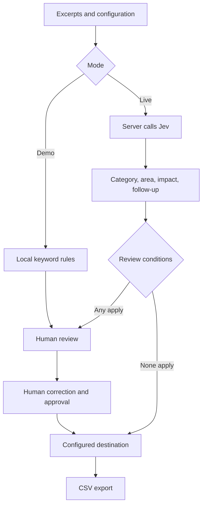

# Voice To Momentum

**Customer signals. Clear owners. Next steps.**

Turn customer feedback excerpts into reviewable, configurable triage decisions.

Voice To Momentum is a small product prototype exploring how Jev's typed judgments can support a PM's feedback workflow. Teams define feedback categories and destinations, inspect uncertainty, correct results, and export their decisions.

> **Status:** Early prototype. The local demo and routing logic have been checked. Live Jev request handling was tested with mocked responses, but real Jev outputs have not yet been validated. There are no published accuracy claims.

## Why build this?

Customer feedback arrives in different forms, while each team has its own categories and ownership rules. This project explores a configurable workflow where AI assesses the evidence and explicit application rules determine whether an item needs review or receives a destination.

It is a portfolio implementation of an existing product capability, not a claim to a new category. Built by Aastha Singh, with AI-assisted implementation.

Live private app: https://voice-to-momentum.adeptwand64.chatgpt.site (owner access required).

## Quick start

Requires **Node.js 20 or newer**. No dependencies or installation step.

```bash
node scripts/local-server.mjs
```

Open **http://localhost:3000**. Choose **Discovery call**, then **Analyze conversation**. Demo mode makes no Jev API calls.

See [SETUP.md](SETUP.md) for live Jev setup and troubleshooting.

## What you can do

- Paste up to 15 feedback excerpts, separated by blank lines.
- Customize categories, destinations, and product areas.
- Assess feedback category, product area, explicit impact, and follow-up need.
- Inspect the question contract sent to Jev.
- Review routing reasons; approve a route or reopen review.
- Correct a category and restore the original result.
- Clear the conversation and export CSV.

## Two distinct modes

| Mode | Assessment | Usage cost |
| --- | --- | --- |
| Demo | Local keyword heuristics; no model probabilities | No Jev charges |
| Live | Actual Jev API request using your key | Consumes TypeSafe credits |

Demo is an interface demonstration, not a simulation of Jev's reasoning or accuracy. Custom category names may not work meaningfully with its fixed keyword rules. Live failures are displayed, never silently replaced with demo outputs.

## How it works



Jev uses `choice` for category, product area and impact, and `noul` for follow-up probability. The current app does not use Jev's `score` primitive.

## Routing policy

An unapproved item requires review when any of these apply:

1. It came from Demo mode.
2. Category confidence is below the configured threshold.
3. Category is `Unclear`.
4. Follow-up probability is above 0.5.

Otherwise, category maps to its configured destination. Missing destination mappings fall back to Human review. Impact and product-area confidence do **not** currently gate routing. Threshold changes affect existing results without a new API call.

Human approval overrides the review conditions. An unclear or unmapped category must first be corrected. Changing or restoring a category clears approval. Routing assigns a label only: no ticket is created and no external team is notified.

## Evidence and limitations

- One paragraph is one item. Full-transcript extraction and mixed-topic splitting are not implemented.
- Impact is a fixed rubric: Not stated, Minor friction, Repeated effort, Workflow blocked.
- Custom categories have names and destinations, not editable detailed definitions yet.
- Only categories are editable in results; product areas and impact are read-only outputs.
- Source excerpts are preserved, but field-level evidence spans and generated rationales are not extracted.
- A model probability is not proof of correctness. Default thresholds are not validated.
- Editing a category retains the original model confidence; it is not a new assessment of the edited category. Explicit approval is the human decision.
- Results do not retain a complete historical configuration snapshot. Export before changing configuration or starting another analysis.
- No transcript persistence, integrations, commitment verification, authentication implementation, or evaluation dashboard is included.

## Privacy

Preferences are saved in this browser's localStorage. The app does not persist notes, results or API keys. Live mode sends excerpts and question definitions through the server to TypeSafe; do not assume the hosting provider or TypeSafe has zero retention. The server does not explicitly log request payloads. The local server is for development, not a hardened public deployment.

## Repository guide

| Path | Purpose |
| --- | --- |
| `worker/index.js` | Embedded UI, decision definitions, routing logic and Jev proxy |
| `scripts/local-server.mjs` | Node development adapter |
| `examples/` | Synthetic excerpts and provisional expected labels |
| `docs/ARCHITECTURE.md` | Data flow and code responsibilities |
| `docs/VALIDATION.md` | Model validation and routing checks |
| `docs/ROADMAP.md` | Candidate next steps |

## Before showcasing live Jev

Run the examples, manually review the labels, pin a model version, and publish measured results with limitations. See [validation guide](docs/VALIDATION.md).

Official references: [TypeSafe quick start](https://docs.typesafe.ai/introduction/quickstart), [model documentation](https://docs.typesafe.ai/models).

## License

No open-source license has been selected. Public visibility alone does not grant a general reuse license; choose one before presenting this as open-source software.
